# Despliegue de la Pokédex en Azure

Aquí explico, paso a paso, cómo desplegué la Pokédex en Azure Static Web Apps y cómo la llevé de una nota **C** a **A+** en seguridad.

**App en vivo:** https://red-smoke-06aca7e1e.3.azurestaticapps.net

---

## Cómo quedó montado

```
Mi PC (WSL2)  →  GitHub  →  GitHub Actions  →  Azure Static Web Apps  →  Usuario
               (git push)    (compila la app)    (la publica con HTTPS
                                                   y headers de seguridad)
```

Cada vez que hago `git push`, GitHub Actions compila la app y Azure la publica automáticamente.

| Herramienta | Versión |
|---|---|
| Angular | 14.1.1 |
| Node.js | 16 (manejado con nvm) |
| Entorno | Windows + WSL2 (Ubuntu) |
| Hosting | Azure Static Web Apps, plan Free |

---

## Paso 1: Preparar el proyecto

### Usar la versión correcta de Node

El proyecto usa Angular 14, que solo funciona con Node 14 o 16. Yo tenía Node 24, así que instalé Node 16 con **nvm** sin borrar la otra versión:

```bash
nvm install 16
nvm use 16
echo "16" > .nvmrc     # deja guardada la versión del proyecto
```

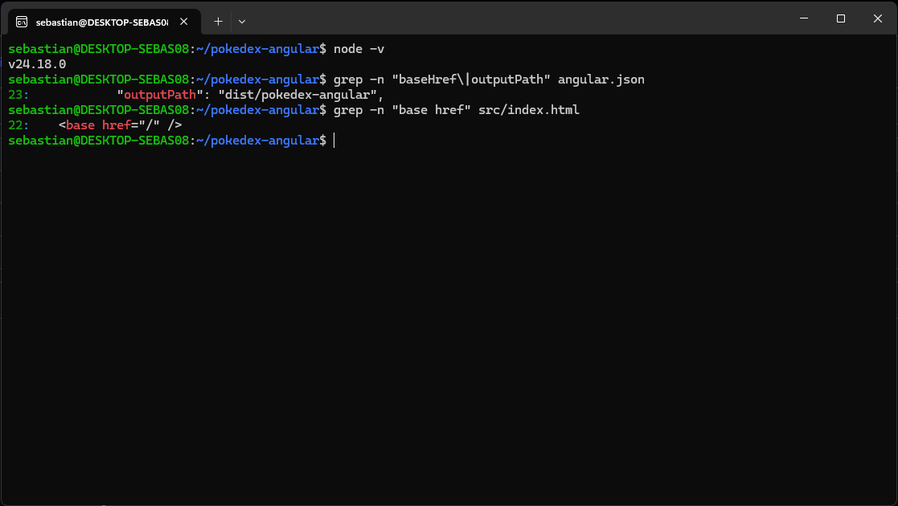

### Clonar el repo y copiar el código

```bash
git clone git@github.com:SebastianAprog08/pokedex.git
rsync -av --exclude node_modules --exclude dist --exclude .git \
  ~/projects/pokedex-angular/ ~/projects/pokedex/
```

No copié `node_modules` ni `dist`, porque se generan solos, ni el `.git` del autor original.

### Limpiar lo que no servía

- Borré el pipeline del autor (`.github/workflows/pipelines.yml`): corría tests con un token suyo, así que en mi repo iba a fallar.
- El proyecto trae revisiones automáticas al hacer commit (husky). No tienen que ver con el despliegue, así que las salté con `HUSKY=0`.

---

## Paso 2: Probar en local

```bash
npm ci          # instala las dependencias exactas
npm start       # abre la app en http://localhost:4200
npm run build   # genera la versión final en dist/pokedex-angular
```

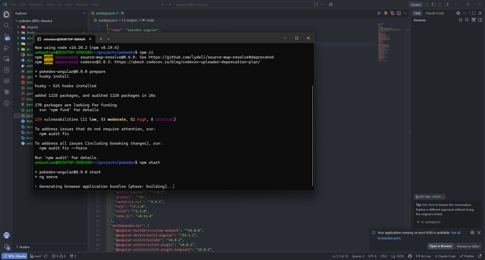

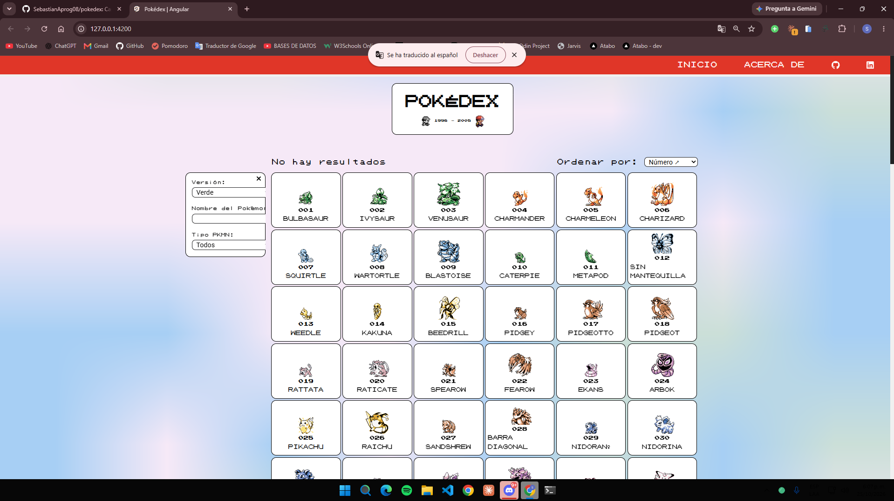

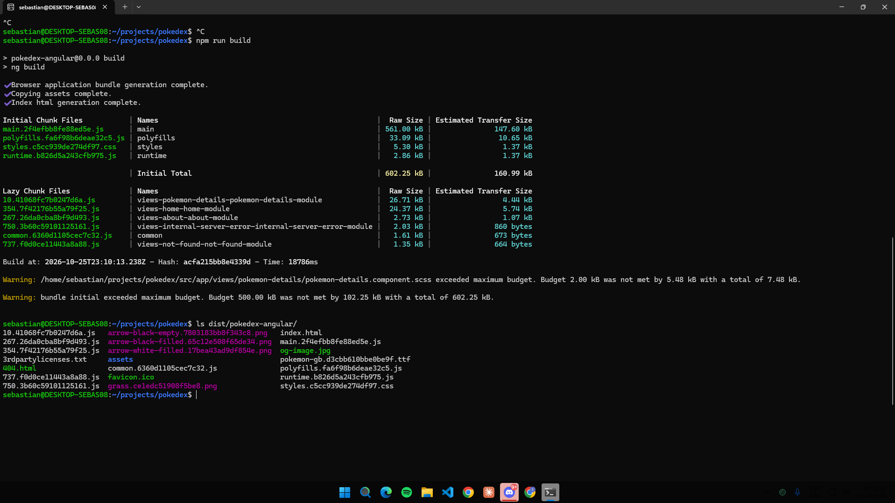

Con todo funcionando, subí el código a GitHub:

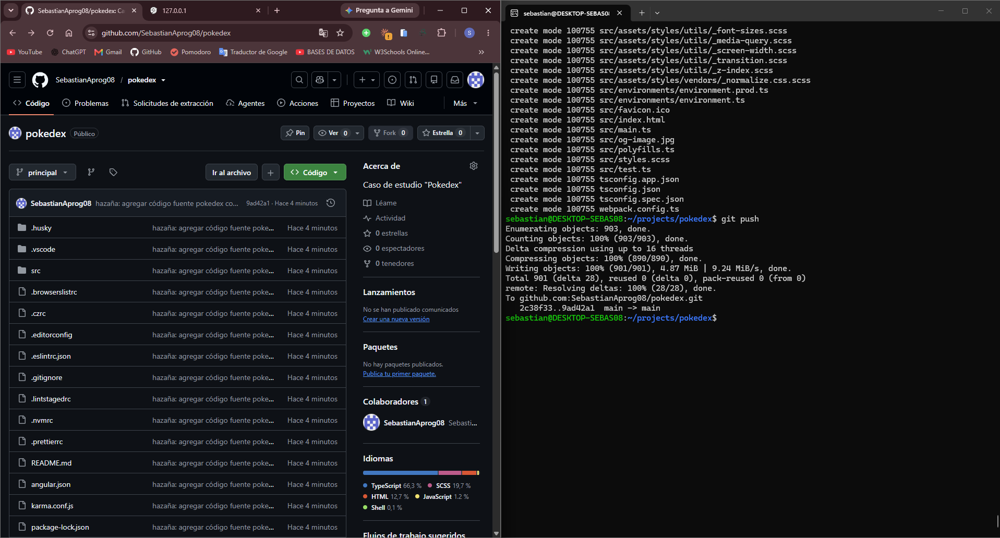

---

## Paso 3: Crear la Static Web App

En el portal de Azure: **Static Web Apps → Crear**. El detalle de cada campo está en el [README](README.md#parte-2-configuración-inicial-del-recurso).

| Campo | Valor |
|---|---|
| Grupo de recursos | `rg-pokedex` |
| Plan | Free |
| Origen | GitHub → repo `pokedex`, rama `main` |
| Preset | Angular |
| Carpeta de la app | `/` |
| Carpeta de salida | `dist/pokedex-angular` |

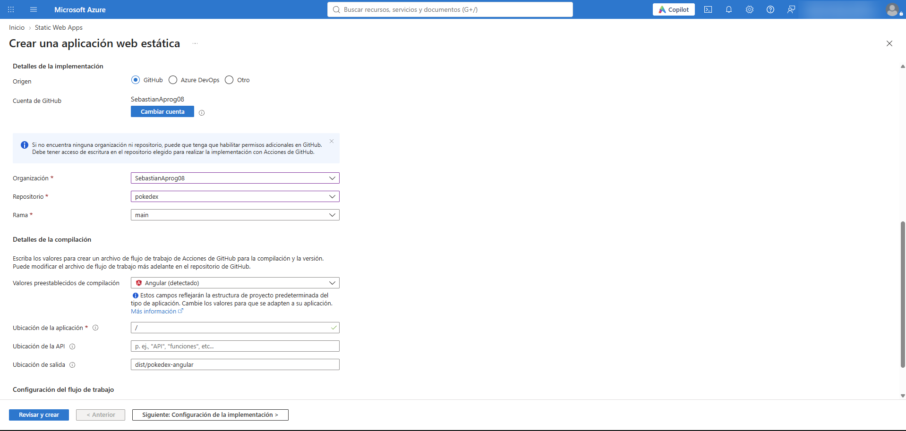

Al crearla, Azure agregó a mi repo un archivo de **GitHub Actions** que despliega la app con cada push.

---

## Paso 4: Arreglar el pipeline

El primer despliegue falló. La app **sí compiló**, pero el compilador de Azure (Oryx) se cayó con un error interno.

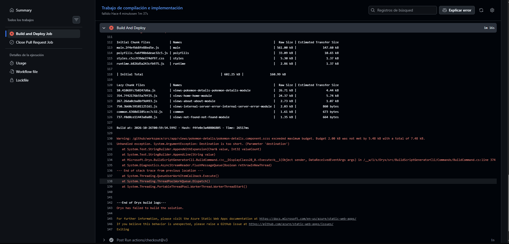

**Solución:** hice que GitHub Actions compilara la app con Node 16 y que Azure solo se encargara de publicarla. En el workflow agregué estos pasos:

```yaml
      - name: Setup Node 16
        uses: actions/setup-node@v4
        with:
          node-version: 16

      - name: Instalar dependencias
        run: npm ci

      - name: Build Angular
        run: npm run build
```

Y en el paso de Azure le indiqué que no compilara:

```yaml
          app_location: "dist/pokedex-angular"
          skip_app_build: true
```

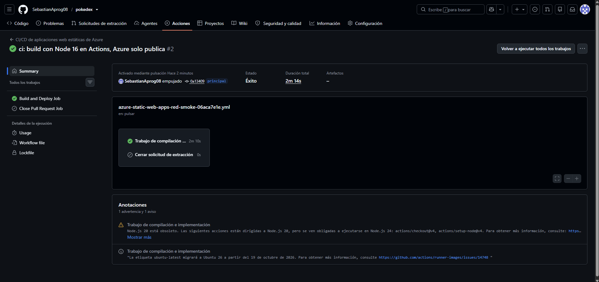

---

## Paso 5: Arreglar las imágenes

La app cargó, pero sin los sprites de los Pokémon. En la consola del navegador aparecían errores **404**.

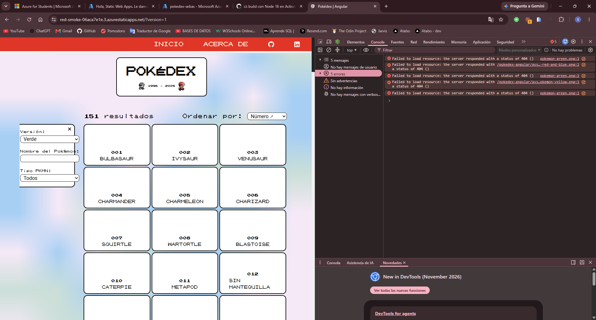

**Causa:** en `environment.prod.ts` quedó la ruta que el autor usaba en GitHub Pages. En local funcionaba porque ese archivo solo se usa en producción.

```ts
imagesPath: '/pokedex-angular/assets/images',   // antes
imagesPath: '/assets/images',                   // después
```

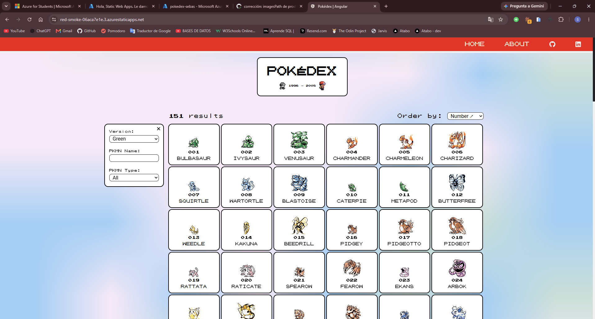

---

## Paso 6: Seguridad, de C a A+

### El punto de partida

El primer escaneo en securityheaders.com dio **C**. Azure ya trae 3 headers por defecto, pero faltaban **Content-Security-Policy**, **X-Frame-Options** y **Permissions-Policy**.

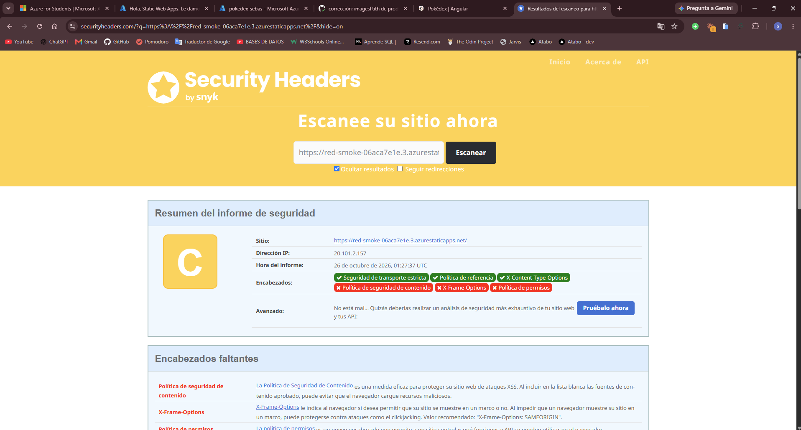

### Preparar el código

Antes de activar los headers tuve que quitar dos fragmentos de JavaScript que venían escritos dentro del HTML. Con una CSP segura, el navegador los habría bloqueado:

- Un script que el autor usaba para GitHub Pages en `index.html`. En Azure ya no hace falta, así que lo eliminé.
- Una optimización de Angular que carga el CSS con JavaScript. La desactivé en `angular.json` con `"inlineCritical": false`.

### Configurar los headers

Creé `src/staticwebapp.config.json`. Azure lee este archivo y agrega los headers a cada respuesta:

```json
{
  "navigationFallback": {
    "rewrite": "/index.html",
    "exclude": ["/assets/*", "*.{css,js,png,jpg,gif,svg,ico,ttf,woff,woff2,json}"]
  },
  "globalHeaders": {
    "Content-Security-Policy": "default-src 'self'; script-src 'self'; style-src 'self' 'unsafe-inline' https://fonts.googleapis.com; font-src 'self' https://fonts.gstatic.com; img-src 'self' data: https://assets.pokemon.com; connect-src 'self' https://pokeapi.co https://beta.pokeapi.co; object-src 'none'; base-uri 'self'; form-action 'self'; frame-ancestors 'none'",
    "Strict-Transport-Security": "max-age=31536000; includeSubDomains",
    "X-Frame-Options": "DENY",
    "X-Content-Type-Options": "nosniff",
    "Referrer-Policy": "strict-origin-when-cross-origin",
    "Permissions-Policy": "camera=(), microphone=(), geolocation=(), payment=(), usb=()"
  }
}
```

| Header | Para qué sirve |
|---|---|
| Content-Security-Policy | Lista blanca de lo que la página puede cargar. Protege contra XSS |
| Strict-Transport-Security | Obliga a usar siempre HTTPS |
| X-Frame-Options | Evita que metan mi sitio dentro de otro (*clickjacking*) |
| X-Content-Type-Options | Evita que el navegador ejecute archivos con un tipo equivocado |
| Referrer-Policy | Controla qué información de mi URL se comparte con otros sitios |
| Permissions-Policy | Bloquea el acceso a cámara, micrófono, ubicación, etc. |

`navigationFallback` hace que al recargar una página como `/about` no salga un 404, sino que Angular se encargue de mostrarla.

Para que Azure encuentre el archivo, lo agregué a la lista `assets` en `angular.json`. Así se copia a la carpeta que se publica.

### La CSP en acción

Al activarla, el navegador bloqueó la imagen grande de la página de detalle, porque venía de `assets.pokemon.com` y ese dominio no estaba en la lista. Lo agregué a `img-src` y quedó funcionando.

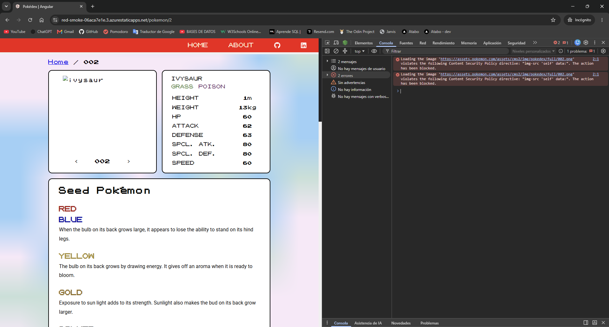

### Verificación

```bash
curl -sI https://red-smoke-06aca7e1e.3.azurestaticapps.net
```

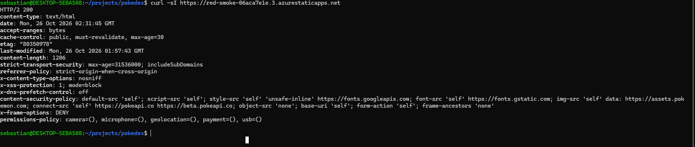

### Resultado final

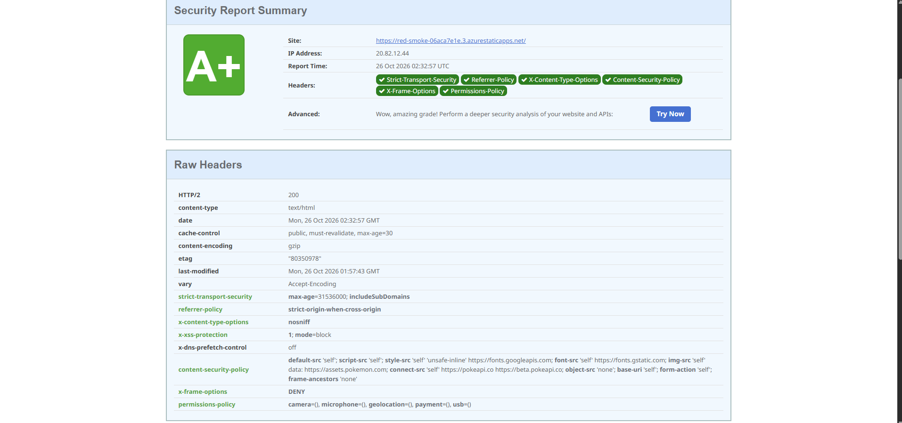

| Antes | Después |
|---|---|
| **C**: 3 de 6 headers | **A+**: 6 de 6 headers |

---

## Problemas que encontré

| Problema | Solución |
|---|---|
| Node 24 no era compatible con Angular 14 | Usé Node 16 con nvm |
| Mi suscripción de estudiante no dejaba crear el recurso en ninguna región | Usé la suscripción Azure for Students de otra cuenta estudiantil y conecté mi GitHub ([detalle](README.md#parte-3-un-problema-al-crear-el-recurso)) |
| El compilador de Azure (Oryx) fallaba | Compilé en GitHub Actions y Azure solo publica |
| Las imágenes daban 404 | Corregí la ruta en `environment.prod.ts` |
| Recargar `/about` daba 404 | `navigationFallback` |
| La CSP bloqueaba la imagen de detalle | Agregué `assets.pokemon.com` a la CSP |

---

## Extra: auditoría con SSL Labs

Además de securityheaders.com, revisé la configuración HTTPS del sitio con [SSL Labs](https://www.ssllabs.com/ssltest/). Esta herramienta evalúa el certificado y el cifrado de la conexión.

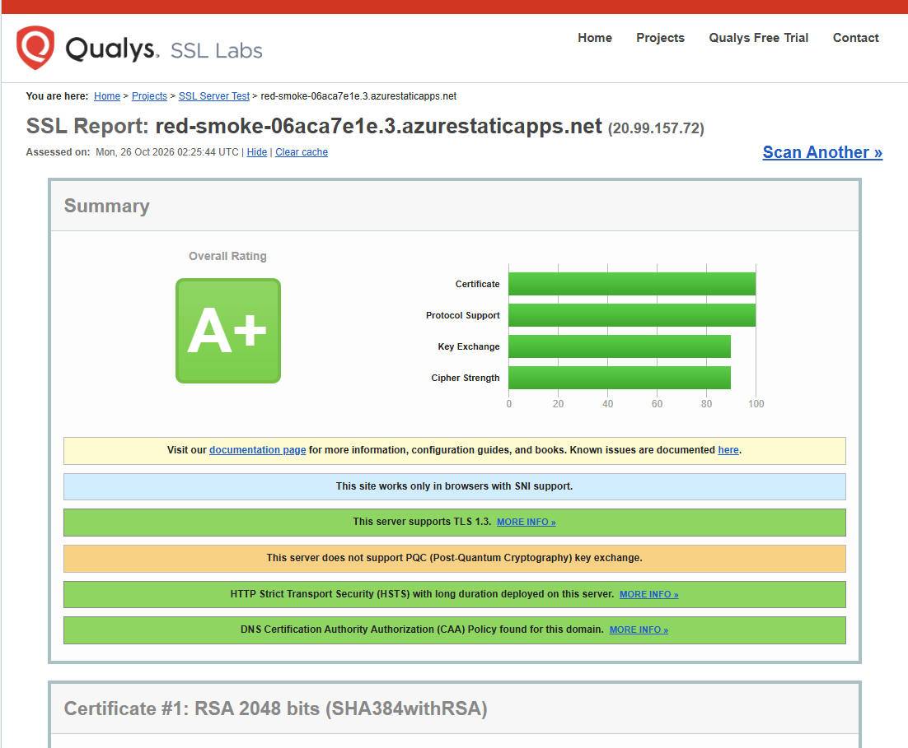

| Resultado | Qué significa |
|---|---|
| **A+** | Calificación máxima |
| TLS 1.3 | Usa la versión más reciente y segura del protocolo de cifrado |
| HSTS de larga duración | Detectó el header que configuré (1 año) |
| CAA | El dominio indica qué autoridades pueden emitir su certificado |
| Sin PQC (aviso naranja) | No usa criptografía post-cuántica. El cifrado lo administra Azure, así que no es algo que yo pueda configurar en el plan Free |
