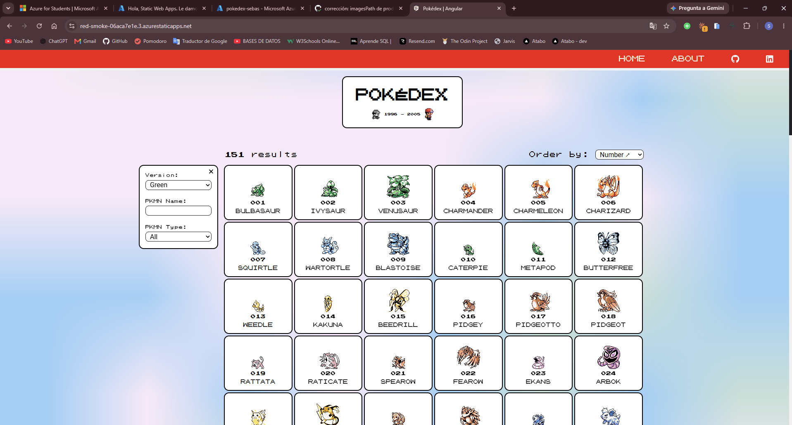
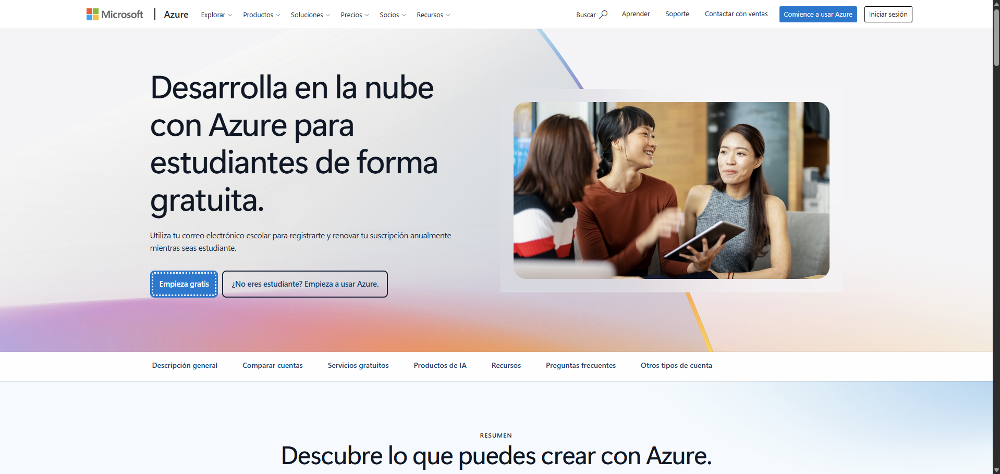
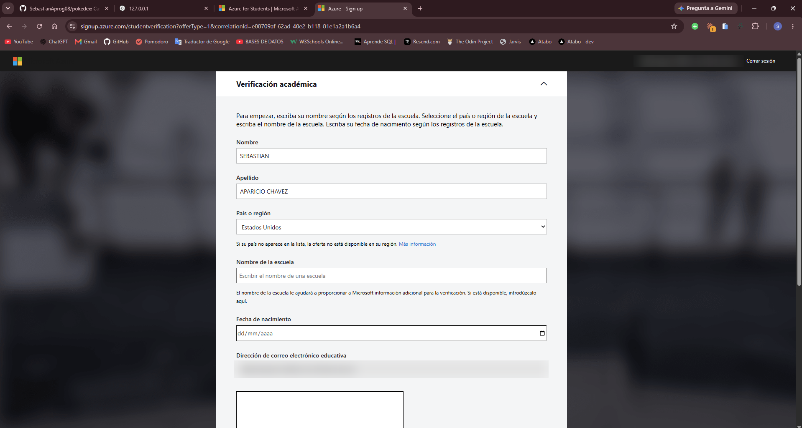
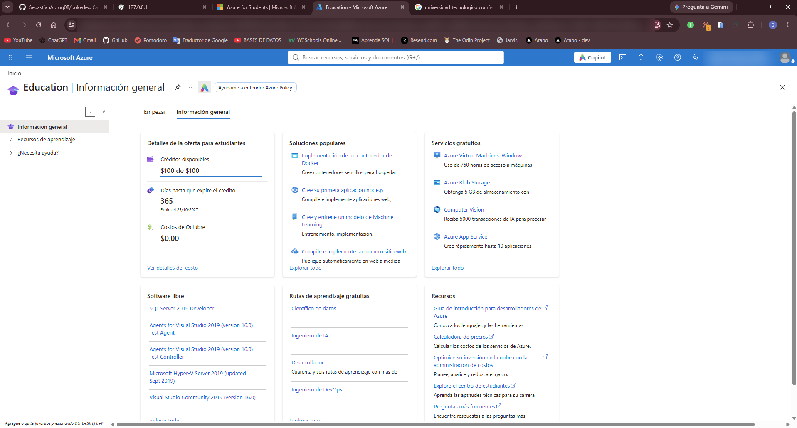
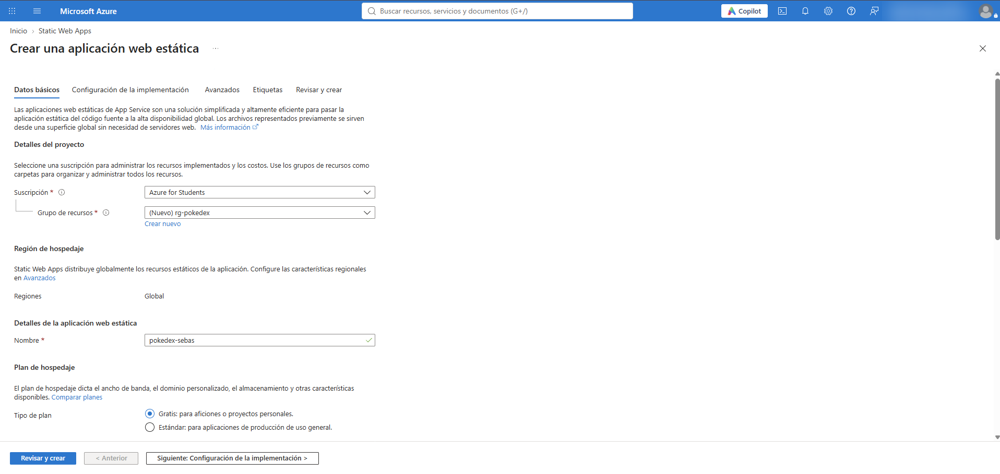
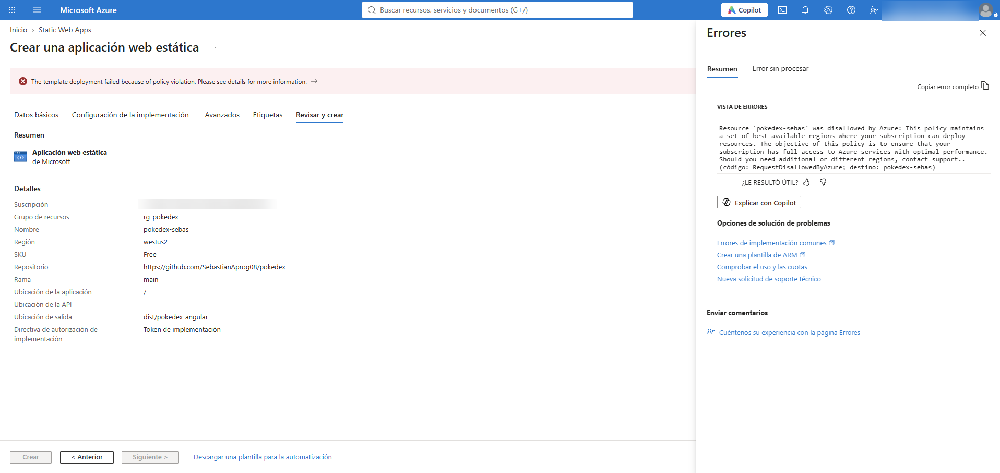
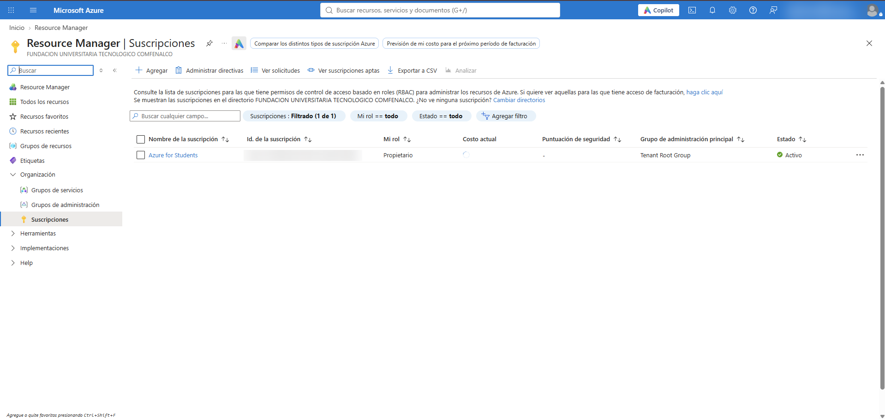

<p align="center">
  
</p>

<h1 align="center">Pokédex en Azure</h1>

<p align="center">
  
  
  
  
  
</p>

<p align="center">
  <a href="https://red-smoke-06aca7e1e.3.azurestaticapps.net"><b>Ver la app en vivo</b></a> ·
  <a href="Despliegue.md"><b>Cómo la desplegué</b></a>
</p>

---

## Sobre el proyecto

La empresa **Pueblo Paleta Inc.** necesitaba publicar su aplicación **PokeDex** en una nube pública, cumpliendo normas de seguridad web. En este repositorio está el código desplegado y la documentación de todo el proceso.

| | |
|---|---|
| **Nube** | Microsoft Azure (Azure for Students) |
| **Servicio** | Azure Static Web Apps, plan gratuito |
| **Despliegue** | Automático con GitHub Actions en cada `git push` |
| **Seguridad** | Nota **A+** en [securityheaders.com](https://securityheaders.com) |
| **Código original** | [keilermora/pokedex-angular](https://github.com/keilermora/pokedex-angular), de Keiler Mora |

**Autor del despliegue:** Sebastián Aparicio Chávez · Ingeniería de Sistemas · Tecnológico Comfenalco · Sistemas Distribuidos

---

## Por qué elegí Azure Static Web Apps

Cuando se compila, la Pokédex queda convertida en archivos estáticos: HTML, CSS y JavaScript. No necesita un servidor que ejecute código, solo uno que entregue esos archivos. Con eso en mente comparé las opciones de Azure:

| Opción | ¿Sirve? | Por qué |
|---|---|---|
| Máquina virtual | Funciona, pero sobra | Tendría que instalar, configurar y mantener un servidor web, y el certificado HTTPS correría por mi cuenta |
| Blob Storage | No | No permite configurar headers de seguridad sin pagar un servicio extra, así que no se puede llegar a A+ |
| **Static Web Apps** | **Sí** | Está hecho para apps estáticas, es gratis, trae HTTPS incluido y permite configurar headers de seguridad |

---

## Parte 1: Crear la cuenta en Azure

### 1. Entrar a la oferta para estudiantes

Entré a la página de **Azure for Students** y le di clic en **Empieza gratis**.

> Hay que tener cuidado de no entrar a la cuenta gratuita normal de Azure (el botón *"¿No eres estudiante?"*). Esa pide tarjeta de crédito; la de estudiantes no.



### 2. Verificación académica

Inicié sesión con mi correo institucional `@tecnocomfenalco.edu.co` y llené el formulario con mis datos tal como aparecen en la universidad. Con el correo, Microsoft comprueba que soy estudiante activo.



### 3. Cuenta lista

Al terminar, el portal de Azure me mostró los beneficios de la suscripción:

- **USD 100 de crédito**
- **365 días** de vigencia
- **USD 0** de consumo, porque el plan que usé es gratuito



---

## Parte 2: Configuración inicial del recurso

Con la cuenta lista, creé el recurso donde vive la app: **Static Web Apps → Crear**.

### Datos básicos



| Campo | Lo que puse | Por qué |
|---|---|---|
| Suscripción | Azure for Students | De ahí sale el crédito |
| Grupo de recursos | `rg-pokedex` (nuevo) | Funciona como una carpeta que agrupa todo lo del proyecto. Si lo borro, se borra todo junto |
| Nombre | `pokedex-sebas` | Nombre interno del recurso |
| Región | Global | Static Web Apps distribuye los archivos en servidores de todo el mundo |
| Plan | Gratis | No tiene costo e incluye todo lo que necesitaba |

### Conexión con GitHub


| Campo | Lo que puse | Por qué |
|---|---|---|
| Origen | GitHub | Para que cada `git push` publique la app sola |
| Repositorio / rama | `pokedex` / `main` | Donde está el código |
| Preset | Angular | Azure lo detectó automáticamente |
| Ubicación de la app | `/` | Ahí está el `package.json` |
| Ubicación de salida | `dist/pokedex-angular` | La carpeta que genera el build de Angular |

Al darle **Crear**, Azure hizo dos cosas en mi repositorio:

1. Agregó un archivo de **GitHub Actions** (`.github/workflows/`) con los pasos para desplegar.
2. Guardó un **token secreto** con el que GitHub se autentica ante Azure para poder publicar.

---

## Parte 3: Un problema al crear el recurso

El primer intento falló con el error `RequestDisallowedByAzure`.



**Por qué pasó:** las cuentas de estudiante tienen una regla de Azure (*Azure Policy*) que solo deja crear recursos en algunas regiones. La región que Azure eligió para la Static Web App (`westus2`) no estaba en esa lista.

Las regiones permitidas se pueden ver en **Directiva → Asignaciones → Allowed resource deployment regions**.

**Cómo lo resolví:** probé con todas las regiones disponibles en mi suscripción y ninguna funcionó. Por eso usé **otra cuenta estudiantil de Azure for Students** (también de la universidad), donde la política sí permitía crear el recurso.



Desde esa cuenta creé la Static Web App con la misma configuración de la Parte 2 y **conecté mi cuenta de GitHub** (`SebastianAprog08`). Así el código, el repositorio y el pipeline siguen siendo los míos: la otra cuenta solo aporta la suscripción donde vive el recurso.

> **Lección:** antes de elegir un servicio en una cuenta de estudiante, conviene revisar las regiones permitidas por la política de la suscripción.

---

## Resultado

La app quedó publicada en **https://red-smoke-06aca7e1e.3.azurestaticapps.net** y pasó de una nota **C** a **A+** en seguridad.

El paso a paso del despliegue, los errores que encontré y cómo configuré la seguridad están en **[Despliegue.md](Despliegue.md)**.

---

## Estructura del repositorio

```
pokedex/
├── .github/workflows/          → pipeline de despliegue (GitHub Actions)
├── capturas/                   → imágenes de esta documentación
├── src/
│   └── staticwebapp.config.json  → headers de seguridad y rutas
├── README.md                   → este archivo
└── Despliegue.md               → paso a paso del despliegue
```
